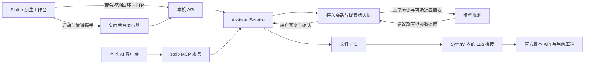

# 架构与实现边界

当前 0.4 工作台以 Flutter Windows 原生客户端为主入口，由 `AssistantService` 编排文字会话、选区参数规划和宿主预览。左侧管理会话与功能页面，中央承载会话、模型服务和连接诊断，右侧工程检查器读取当前选区、显示参数目录并进行手动预览。旧 `web/` 保留为兼容实现，不能代替当前桌面流程。

Windows 上的 Synthesizer V Studio 2 Pro 2.2.1 是既有真机验证基准；2.3.0 的官方更新、公开接口和本轮适配见 [2.3.0 能力核对](synthv-230-support.md)。版本号不能代替运行时能力检测。Flutter 与 MCP 均不直接操作 SynthV 内存，不执行模型生成的任意 Lua 或系统命令。

## 模块职责

| 模块 | 当前职责 |
| --- | --- |
| `desktop/lib/main.dart`、`core/backend.dart` | 原生窗口、系统主题、后台握手、生命周期和有界退出 |
| `desktop/lib/workbench.dart`、`core/workbench_model.dart` | 会话导航、草稿、模型选择、请求状态和页面切换 |
| `desktop/lib/pages/` | 模型服务、SynthV 连接、工程检查器和会话管理 |
| `desktop/lib/widgets/` | 组合曲线预览、参数编辑及统一下拉/展开控件 |
| `synthv_assistant/desktop_runtime.py` | 随机回环端口、管道令牌、实例保护、忙碌退出检查和任务收尾 |
| `synthv_assistant/server.py`、`mcp_server.py` | 受控 HTTP 与 stdio MCP 协议边界，拒绝已退役音频请求 |
| `synthv_assistant/service.py` | 共享业务入口、备份、桥接绑定、参数预览/应用/恢复 |
| `synthv_assistant/conversations.py` | 持久会话、历史预算、提案指纹、组合确认与防重放 |
| `synthv_assistant/planner.py`、`prompts.py` | 文字与选区规划、结构化提案、集中提示词和数值白名单 |
| `synthv_assistant/streaming.py` | 有界 SSE、有效输出续期、凭据脱敏和公开摘要聚合 |
| `synthv_assistant/platforms.py`、`settings.py` | DPAPI 配置、默认平台兼容入口、版本检查与原子保存 |
| `synthv_assistant/model_catalog.py`、`model_options.py` | 本地目录缓存、显式目录测试、模型及推理档位规则 |
| `synthv_assistant/parameters.py` | 动态参数目录、输入契约、有界曲线与计算音高公开字段 |
| `synthv_assistant/note_curves.py`、`pitch_shapes.py` | 按真实音符时间编译局部包络与原生音高候选 |
| `synthv_assistant/operations.py`、`bridge.py`、`bridge_setup.py` | 跨进程锁、IPC 请求、脚本安装和连接目录核对 |
| `synthv/bridge.lua`、`synthv/pitch.lua` | 官方 API 读取、通用自动化、原生音高、快照及写后核验 |
| `assets.py`、`analysis.py`、`capture.py`、`review.py` 及旧音频页面 | 历史兼容与归档实现；不构成当前工作台开放的音频功能 |

## 桌面状态与持久会话

主题、边栏宽度等外观偏好由 Flutter 本地偏好存储管理，不读取浏览器 `localStorage`。模型服务采用平台列表与详情分栏；保存连接可以先不填写默认模型。离开设置或切换平台前保护未保存草稿，保存失败保留非密钥内容并清空密钥输入。会话模型选择一次确定平台与型号，不产生先切平台再误用默认模型的中间状态。

控件共用灰阶主题、34 像素框高和正文样式。`WorkbenchDropdown` 约束真正绘制边框的 `InputDecorator`，不只限制外层容器。`WorkbenchExpansionTile` 为展开状态设置独立存储键，并隔离展开内容的 `PageStorage`；否则父级滚动位置、展开布尔值及内部输入框滚动会互相覆盖，切页后产生类型错误。

会话保存于 `data/conversations/{32位编号}.json`。每个会话最多 100 条消息、2 MB，最多 200 个活跃会话；移入回收站释放活跃容量，恢复时重新校验。每条用户输入最多 4000 字符，模型上下文最多包含最近 8 条文字历史、每条最多 2000 字符。历史摘要不再次进入模型上下文，历史音频附件不读取或重传。

`includeSelection=false` 时只进行文字咨询，不读取选区，也不形成可执行动作。附带选区时必须成功读取非空当前音符选区。模型只得到白名单内的音符、时间、组移调、参数标签、单位、范围、限幅与能力信息；工程路径、内部组标识、桥接会话、完整参数指纹和声库原始文件信息不进入规划上下文。

会话备注、星标、名称和删除标记单独保存于 `data/metadata/`，备注不作为模型指令。移入回收站可以恢复；永久删除要求明确确认，只删除对应会话与元数据，不级联 SynthV 工程、备份或历史音频。删除和会话写回受锁保护，防止在途请求复活已删文件。

## 平台与流式请求

固定 `default` 平台继续使用历史文件名 `audio-settings.json`，这是配置兼容命名，不表示仍开放听评。其他平台保存在 `model-platforms.json`，最多 20 个平台。完整配置以当前 Windows 用户 DPAPI 加密；默认平台和平台注册表各有锁及 revision。保存使用同目录临时文件、`fsync` 和原子替换，过期页面不能覆盖新配置。

密钥不回填。只有协议和规范化根地址均未变化时，空白输入才表示沿用原密钥；更换目标必须重新填写。停用保存无凭据状态，默认平台的停用覆盖环境后备；命名平台不继承其他平台或环境密钥。配置损坏或无法解密时拒绝相应调用。

`defaultPlatformId` 只决定新建会话的初始平台，已有会话保留自己的选择。会话 `modelOptions` 仅保存 `platformId`、`model` 和 `reasoningEffort`，不保存地址或密钥；空模型跟随平台默认值。仅保存连接而未选定最终模型时，发送在读取文件或联网前拒绝。请求开始后固定使用一份平台快照，不在途中混用新地址与旧凭据。

模型目录读取和能力查询默认只查本机数据。显式获取目录或测试连接才访问供应商；连接测试只验证目录接口，不生成模型回复，也不证明指定模型支持推理或当前账户可调用。目录请求最多 5 页、500 个模型，每页最多 2 MB，等待不超过 30 秒，不跟随重定向或任意下一页地址。目录缓存绑定平台、协议、地址与凭据身份；身份摘要经 DPAPI 加密。读取上限为 512 KiB，超过七天仅标记陈旧；刷新失败保留原缓存。

模型列表不等于能力声明。已知系列按本地规则提供推理档位，未知兼容模型标记未验证；不支持的档位由后端拒绝。用户切换模型时，桌面会将不兼容的旧档位恢复为新模型默认并明确提示。平台或模型变化会使旧能力快照失效，迟到结果不得覆盖新选择。

模型调用的 SSE 在后台聚合，桌面只轮询既有任务编号，显示真实阶段、等待时间和供应商公开摘要。非空正文或公开摘要会续期 5～180 秒的等待预算；心跳、注释和空事件不续期。整次流式请求另有限制为 30 分钟。断连或结果未知时不自动重发，不以重新计费调用掩盖失败。

原始传输、单行/单事件、正文和摘要预算分别为 32 MiB、1 MiB、24,000 字符和 12,000 字符。正文超限失败；摘要只截断展示，后续有效输出仍续期。缺少正常结束标记或正文结构不完整时不生成可应用提案。摘要经过跨事件凭据脱敏，只作本地展示，不冒充隐藏思考，也不解释为工具调用。提示词只指导输出，不能替代代码校验，详见 [提示词规范](prompt-guidelines.md)。

## 参数目录与曲线语义

Lua 只接受白名单内的工程/选区读取、参数预览、应用、恢复与写入模式切换。默认只读，不提供任意代码执行、动态原生库加载或工程文件重写。选区最多 128 个音符、30 秒；当前音符组在多个位置共享时拒绝修改。新曲线操作必须协商 `capabilities.curves=true`。

参数目录由当前宿主真实返回。通用自动化包括气声、张力、响度、性别、音高偏移、音色偏移、颤音包络，以及当前宿主确实开放的 `voicing`（浊音/清音）。`voicing` 单次偏移上限为 0.3，最终值域按宿主定义约束；旧桥接不能凭静态回退表启用此参数。

声线目录合并轨道主组与当前组 `getVoice().vocalModeParams` 已有名称，并允许用户核对 SynthV 面板后临时补充。目录明确返回 `complete=false`，不能声称已枚举声库全部声线，也不能按声库名称猜测 Airy、Chest 或 Cute。`voiceValues` 中的 pitch/timbre/pronunciation 是只读默认设置，与 `vocalMode_Name` 自动化通道不同；不构造未经公开 API 支持的三维独立通道。

用户补充声线名称走 `POST /api/parameters/vocal-mode`，要求当前工程、组、移调及声库身份一致。补充项仅存于当前桥接会话，标记 `source=user`；宿主项标记 `source=host`。此过程不写工程、不自动启用写权限，也不向模型开放任意名称注册工具。

参数候选使用增量或 2～64 个 `[position,value]` 曲线点，二选一。横轴为选区真实时间比例，严格递增且首尾为 0、1；拒绝布尔数值、数字字符串、非有限值和未知字段。通用参数与声线曲线的纵轴为偏移，非零曲线不能突破本地上限或宿主较小限幅。声线最大 30 个百分点；气声/张力/性别/颤音包络/voicing 最大 0.3，响度 6 dB，音高偏移 100 音分，音色偏移 200 音分。

`smooth` 默认精简通用自动化节点，`points` 保留显式控制点。两种表示都通过官方 `Automation` 写入，不能把精简点称为声线专用原生连续对象。`noteCurves` 由本地编译器按真实音符秒坐标生成偏移曲线，不把模型高层格式或代码直接交给 Lua。

真正的原生音高是 `pitchCurve` 对应的 `PitchControlCurve`，要求 `capabilities.nativePitch=true` 且当前目录标记可用。它只接受 smooth 绝对 MIDI 半音曲线，不接受 delta 或 points；输入范围为选中音符含组移调后的最低至最高音上下各 2 半音，并与 0～127 取交集。内部按组时间和移调转换坐标，候选对象在应用前不附加到工程。不能用密集 `pitchDelta` 控制点冒充原生音高已可用。

普通润色优先保留现有演唱音高并使用小幅偏移。明确要求原生重绘时，可将 `pitchShape` 的每音符 2～8 点相对音分包络与 5～120 毫秒过渡编译为绝对 MIDI；单点偏移限 ±50 音分，整体仍受 64 点约束，不能靠删除短音符满足限制。候选按音符主体位置校验，避免粗略线段越过实际旋律。

`computedPitch` 是宿主已计算音高的只读采样，既不是乐谱音高，也不是可直接写回的对象。空结果表示未就绪，缺帧保留 null，不填零或用音符基准伪造演唱基线。参数图展示音符音高排列及独立参数轨道；多参数可合并预览，以不同系列色区分单位。真实控制点和最多 256 个预览样本分别受限。图形不代表已应用，也不能证明听感改善。更多坐标、边缘保护和复用约束见 [参数曲线契约](parameter-curves.md) 与 [调教生成逻辑](tuning-quality.md)。

## 预览、确认与恢复

提案状态为 `proposed`、`previewed`、`unknown`、`applied`。模型一次最多提供五种不同参数；经过当前目录、范围和结构校验后保存为建议，不能直接修改工程。

预览读取当前选区、参数完整快照与能力，在内存中构造候选。通用自动化保留区外节点，并由宿主真实插值核对边界影响；不满足区外误差约束或超过 4000 点时拒绝。原生音高保留独立对象、次序、锚点、内部点与可读脚本元数据快照；跨界曲线、引导点和相关 pitchDelta 仍参与保护。

宿主只保留最近一次预览，预览有效期为 300 秒。生成新预览会使其他会话旧确认资格失效。未应用建议允许在目标内容一致时重新建立参数基线；单纯重连或手动修改参数不必重新请求模型，但跨连接必须有完整指纹。切换到另一片段需要显式“复用到当前选区”，重新映射、校验并生成新预览，不能仅凭音高相同重放旧确认。

确认应用时再次核对本次桥接、选区、声库、目标参数及依赖指纹。真正写入前先持久化 `unknown`，建立 SynthV 撤销记录；写后通过宿主读回验证才标记 `applied`。失败尝试回滚并验证；无法确认或回滚失败时保留未知状态和可恢复信息，禁止自动重放。组合预览要求宿主 `batchPreview` 能力，组合应用同样使用专门确认票据与各参数快照。

已验证应用成功的提案，只有确认参数完整恢复到原指纹后才能再次生成预览；先清除旧应用结果与票据，再回到建议状态。`unknown`、缺少完整指纹或仅点数相同不能作为重新应用依据。助手恢复只针对最近一次可验证修改，要求同一工程/组且当前曲线仍等于助手写入结果，不是多级持久历史。

开启写入时先将已保存、可访问的 `.svp` 复制到 `data/backups`，成功后才请求宿主允许修改。磁盘副本不包含尚未保存的编辑；本助手不调用不存在的保存接口，也不自动保存最终工程。原生崩溃时 Lua 异常处理无法保证执行，工程保存、副本和 SynthV 原生撤销仍是恢复手段。

## 并发、IPC 与进程生命周期

会话请求使用各自文件锁，等待模型期间不占工程操作锁。短时提案状态转换由 `assistant.lock` 串行化；会话文件采用同目录临时文件、`fsync` 和原子替换，HTTP 与 MCP 不能用旧快照覆盖新状态。

Python 向 IPC 目录写入包含请求编号、桥接会话和截止时间的 JSON。Lua 轮询白名单动作并维护心跳，请求正文不是代码。`client.lock` 保证同一 IPC 目录一次只交换一个请求；`operation.lock` 串行化宿主预览、写入模式、应用及恢复。连接既有脚本后操作锁跟随实际桥接目录，连接管理不能在操作途中替换目标。

锁不覆盖用户阅读提案和确认的全部时间，等待期间的人工编辑由确认前指纹检查发现。超时不代表没有写入，不能自动重放。桥接脚本保存实际 IPC 目录；移动资料或改变启动目录后，应通过“SynthV 连接”核对当前脚本，不能假定旧脚本自动迁移。

Flutter 启动受控 Python 子进程，通过 stdout 握手获取随机端口和令牌，并持有 stdin 管道。正常关闭先检查在途任务，等待后台收尾、释放页面资源，再关闭窗口；忙碌任务不会被当作已取消。任务编号属于创建它的进程，重新启动后不恢复未完成编号，也不自动重发模型请求或结果未知的参数应用。

## HTTP 与 MCP 边界

HTTP 只绑定 `127.0.0.1`，校验 Host、Origin 和本机令牌。桌面使用父进程管道交付的令牌；旧浏览器兼容入口通过 `/api/bootstrap` 获取令牌。请求使用 `X-SV-Token`，不放入 URL、模型配置或公开日志。

| 接口组 | 当前用途 |
| --- | --- |
| `/api/status`、`/api/project`、`/api/selection` | 桥接、写入状态、工程及当前选区读取 |
| `/api/bridge/diagnostics`、`connect`、`install` | 明确核对、绑定或安装桥接脚本 |
| `/api/model-platforms` 及其 `models`、`test-connection`、`default-selection` | 平台配置、缓存、显式目录检查和新会话默认偏好 |
| `/api/model-capabilities` | 查询本地能力规则，不调用云端模型 |
| `/api/conversations` 及消息、选项、元数据、删除和恢复接口 | 持久会话及文字/选区请求；不接受新音频附件 |
| `/api/assistant/actions/{id}/preview`、`apply` | 单项提案预览和确认 |
| `/api/assistant/batches/preview`、`apply` | 多参数组合预览与票据确认 |
| `/api/conversations/{id}/reuse` | 显式将已有建议复用到当前选区，再次校验和预览 |
| `/api/parameters/vocal-mode` | 用户核对后临时补充声线目录 |
| `/api/write-mode`、`/api/preview`、`/api/apply`、`/api/restore` | 手动参数操作，仍经过宿主能力与快照校验 |
| `/api/jobs/{id}` | 查询同一后台任务，不自动创建替代任务 |
| `/api/audio-settings` 及 `clear` | 历史命名的默认平台配置兼容入口，不是音频调用接口 |

MCP 使用本地 stdio，复用同一服务层，无需开放网络服务。当前工具包括 `status`、`get_project`、`get_selection`、`get_parameter_catalog`、`set_write_mode`、`preview_parameter`、`preview_curve`、`apply_preview`、`restore_last_edit` 和兼容任务查询 `get_job`。

`get_parameter_catalog` 返回白名单内的可编辑参数、声线名称及来源、只读声线默认值和可用的计算音高，不发送工程文件路径、原始声库对象或完整私有指纹。先发现当前能力，再提出曲线；`apply_preview` 只接受预览编号，确认阶段不能替换参数或附带执行代码。

MCP 预览与应用是分开的工具，但服务没有独立弹窗强制每次人工确认。客户端工具策略与用户授权必须负责审批；桌面通过明确的预览和确认按钮完成该流程。工具注解或模型提示不能替代审批，也不能绕过写入模式和工程状态核验。

## 音频退役与历史兼容

0.4 起，桌面不再提供音频导入、素材库、录音、试听、附件和 AI 听评入口。已经存在的本地文件、索引和历史消息不会自动删除。内部音频模块及受控历史读取保留是兼容安排，不表示当前模型可以听音，也不能据此重新开放旧操作流程。

HTTP 对 `POST /api/uploads`、`/api/record`、`/api/compare`、`/api/review` 在认证后返回 **410 Gone**，并在读取上传正文或创建任务前终止。会话入口在锁定资料、保存新消息、读取附件或请求模型之前拒绝非空音频附件，当前会话路径只向规划层传递空音频列表。规划器及听评模块仍保留历史音频分支；规划器内部仍按模型能力检查音频输入，入口退役由 HTTP 和会话层执行。历史附件不会重新上传。MCP 不再注册录音、音频列表、比较、听评或返回 `AudioContent` 的工具。

新后台发行包不构建或携带 `ProcessAudioCapture` 及其自包含 .NET。历史 Flutter/Python 依赖暂时保留时，许可仍按实际产物收集，不因入口退役而省略。原始音频流程仅作为 [历史实现参考](audio-review.md) 归档，不是当前操作指南。

## 验证、发布与数据信任

自动化覆盖 Flutter 布局与导航、参数契约、独立 Lua 虚拟机、MCP stdio、DPAPI、并发锁、配置版本、流式响应、音频退役及未知结果保护。测试使用模拟供应商、隔离宿主与临时资料，不证明真实云端效果或所有声库的调教质量。

既有真机经验不能扩大为所有参数、最新版本和全部声库都已验证。新增接口需要更新桥接并在实际安装版本重新读取；不可用能力应显示原因并拒绝写入，不用假曲线补齐。当前桌面发行包组合 Flutter、冻结后台和 Lua 资源；单独安装 Python wheel 不等于部署完整工作台。

公开仓库与发行包不包含私人工程、音频、截图、运行配置或本地验证记录。平台凭据由当前账户 DPAPI 保护；会话、历史文件、备份和操作记录仍可能含歌词、工程路径等私人信息。模型摘要去除路径不意味着工程读取接口或所有本地文件都没有路径。

回环绑定、Host/Origin 校验及令牌防护不是多用户身份认证。服务只供可信本机账户使用，不应经反向代理或端口转发公开；同一账户的其他进程仍可能访问资料或调用 Windows 解密能力。发布边界见 [安全与隐私说明](../SECURITY.md)、[桌面使用说明](desktop-workbench.md) 和 [后台打包说明](desktop-backend-packaging.md)。
