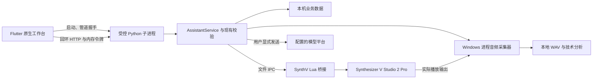

# Windows 原生桌面工作台

桌面端使用 Flutter 构建三栏工作区，保留现有本地调教核心和 SynthV Lua 桥接。它不是网页外壳：会话、设置、素材、录音、预览与检查器由 Flutter 组件实现。旧网页仍留在仓库中，便于兼容与比较；迁移过程中不自动删除旧数据。

## 启动与数据目录

完整发行包解压后双击 `synthv_desktop.exe`。Python 后台和 .NET 音频采集器均随发行包提供，使用者无需另行安装这两个运行时。需要保留应用目录中的 DLL、Flutter 资源和 `backend/`，不能只复制一个 EXE。

面向 Windows x64；按进程录音需要 Windows build 20348 或更新版本。系统还需具备 Microsoft Visual C++ x64 运行库；缺少 `MSVCP140.dll` 等运行库时，应通过微软官方安装程序补齐。当前产物未做代码签名，也不包含自动更新器或 FFmpeg。

| 启动方式 | 默认业务数据目录 |
| --- | --- |
| 完整桌面发行包 | `%LOCALAPPDATA%\SynthV Assistant\data` |
| 仓库内源码开发 | 仓库根目录的 `data/` |
| 设置了 `SYNTHV_ASSISTANT_DATA` | 环境变量明确指定的目录 |

业务数据包括会话、素材、录音、平台设置、模型目录缓存和桥接 IPC。主题、边栏宽度等桌面外观偏好由 Flutter 的本地偏好存储管理，不自动读取浏览器 `localStorage`。因此旧网页选过的主题和边栏宽度不会自动迁移，桌面首次打开默认跟随系统。

源码开发会沿用仓库已有业务数据，但发行包首次运行使用新的用户目录，不会静默扫描或复制旧仓库。若希望继续使用旧资料，可以在启动前为当前进程设置 `SYNTHV_ASSISTANT_DATA`，或在全部相关进程退出后备份、迁移数据。不要边运行边复制资料库；密钥由当前 Windows 用户的 DPAPI 保护，复制文件到其他账户或机器不等于可恢复凭据。

**旧网页和桌面端不要并发管理同一个数据目录。** 桌面进程有实例锁，关键后台操作也有跨进程锁，但旧网页不能同步桌面窗口内的草稿、当前任务和确认资格。切换客户端时先等待任务结束并关闭原服务。业务资料目录与桥接目录分别管理；连接既有脚本不会自动迁移资料。

## 首次连接 SynthV

宿主目标是 Windows 上的 Synthesizer V Studio 2 Pro 独立版，项目既有验证基准为 2.2.1。打开目标工程，在 SynthV 的脚本目录安装并运行对应的 `SynthVAssistant.lua`，再在桌面“工程检查器”中读取选区。

桥接脚本包含本机 IPC 目录。更换 `SYNTHV_ASSISTANT_DATA`、从源码目录切换到发行包默认目录、或移动资料后，可以在“连接管理”继续连接原脚本，也可以安装匹配当前目录的脚本并重新运行桥接；旧脚本不会自动跟随新的数据目录。

桌面版从 0.2.0 起提供“连接管理”主页面。脚本已在 SynthV 中运行、桌面却显示未连接时，先打开此页并刷新诊断：

1. 若提示目录不同且已安装脚本有有效心跳，点击“连接正在运行的脚本”。程序会记住这个明确选择，不移动会话、音频或密钥。
2. 若脚本缺失，或希望改为当前桌面资料目录，点击“安装匹配脚本”，确认后备份并安装。安装完成后仍需在 SynthV 中结束旧桥接，重新扫描并运行脚本。
3. 回到工程检查器，确认“已连接”后读取选区。无需开启写入权限即可诊断、连接和读取。

切换连接目标会清除旧选区草稿和预览确认资格。后端只接受已识别的固定安装脚本，不允许客户端提交任意目录；宿主操作锁跟随实际连接的桥接目录。状态以新心跳为准，不把“脚本已安装”当作“已连接”。

发行包用户在解压后的根目录打开 PowerShell，执行：

```powershell
.\scripts\install-desktop-bridge.ps1 -WhatIf
.\scripts\install-desktop-bridge.ps1
```

`-WhatIf` 只展示目标，不生成或安装文件。正常执行会使用随包后台生成单文件 Lua，将现有同名脚本备份到当前资料目录的 `backups\bridge`，再复制到 `%APPDATA%\Dreamtonics\Synthesizer V Studio 2\scripts\SynthVAssistant.lua` 并校验摘要。脚本不自动打开 SynthV，也不运行桥接或修改工程。

安装之后，在 SynthV 的“脚本”菜单重新扫描并手动运行桥接。若旧桥接仍在运行，先结束旧桥接或重启宿主，再运行新脚本。

自定义目录必须在桥接安装和桌面启动时保持一致。以下示例在发行包根目录执行，只为当前 PowerShell 进程设置环境：

```powershell
$env:SYNTHV_ASSISTANT_DATA = 'D:\SynthVAssistantData'
.\scripts\install-desktop-bridge.ps1
.\synthv_desktop.exe
```

也可给安装脚本传 `-DataDirectory 'D:\SynthVAssistantData'`，但这个参数只影响安装，不会修改永久环境变量；之后双击桌面程序仍需要相同的启动环境。建议使用绝对路径。

源码用户在仓库根目录使用原来的 `scripts/install-bridge.ps1`，它读取项目 `.venv` 并默认绑定仓库 `data/`。发行版安装脚本只使用包内 `backend\synthv-backend.exe`，不依赖本机 Python。

参数写入仍需“允许修改选区”。读取状态、读取选区、生成预览与真正应用是不同操作；开启权限本身不应用 AI 提案。

## 工作台与常用流程

左侧管理会话和页面，中央展示会话、模型设置、素材、录音、连接管理或回收站。界面采用紧凑工具栏、分组属性表单、平铺记录和底部状态栏。右侧工程检查器在会话与录音页提供局部参数工具，在其他页面隐藏但保留草稿。两侧宽度可拖动，窄窗口可收起侧栏；浅色、深色和跟随系统均使用同一套灰阶尺寸规范。

### 文字与音频会话

1. 新建或选择会话，设置平台、模型、推理强度和绘制模式。模型目录优先读取本机缓存；只有明确刷新目录才访问供应商。
2. 输入自然语言目标。纯文字咨询可以不携带音频，也可以不附带选区；希望生成可执行参数提案时，需提供有效宿主选区。
3. 如需听音参考，从素材页选择最多两段音频并“附到会话”，返回输入区检查本次附件。
4. 点击发送后立即显示用户消息，继续显示真实任务阶段、等待时间和供应商公开提供的思考摘要。平台未提供摘要时不会补写或模拟思考内容。
5. 等待完整回复和提案校验后再生成宿主预览。

**导入素材只保存到本地；附到会话只加入当前草稿；点击发送才会把本次附件发给所选模型。** 独立录音页的“提交音频听评”也是显式云端请求。历史消息中的附件不会自动附带到下一次请求；模型不支持音频时需要移除附件或选择适用模型，不会自动转换为另一种付费请求。

### 参数预览与应用

AI 回复中的参数首先是提案，不直接修改工程。点击“生成预览”后，后台核对当前桥接、选区、参数能力和宿主状态。多参数使用组合预览；音符按实际音高排列，参数曲线在独立区域按系列颜色展示，避免把不同单位都当作音高。

确认预览后，用户点击“确认应用”；后台再次检查写入权限及有效预览。切换会话、生成其他预览、重新读取或改变目标后，旧确认可能失效，需要重新预览。需要将旧方案移到另一处时使用“复用到当前选区”，由后台重新映射、校验和生成确认资格，而不是仅按音高相同直接重放。

如果应用结果无法确认，界面保留未知状态，不自动重复提交。先在 SynthV 中检查实际结果。完整撤销后可按后端允许的流程重新预览；旧应用按钮不会作为无限次重放入口。曲线预览展示参数及音符关系，不代表已经完成音频渲染，也不保证听感更优。

### 模型设置

模型设置是独立主页面，可以添加命名平台，编辑协议、API 根地址、默认模型、密钥与等待超时。支持现有核心的 OpenAI/兼容协议、Qwen 和 Gemini。供应商真实音频能力、推理档位和服务区域仍由相应 API 决定，平台名称本身不是能力证明。

密钥不回填；同一平台、同一协议和地址下留空可沿用已保存密钥。改变协议或地址时需要重新填写。保存成功或失败后密码框都会清空，保存本身不调用模型，也不代表云端连接已经验证。后台以当前 Windows 用户的 DPAPI 加密保存配置，并检查版本，防止旧表单覆盖新配置。

“设为新会话默认”只影响之后创建的会话。已存在会话保留自己的平台选择。独立 A/B 听评和兼容 MCP 听评继续使用固定的“默认配置”，不会随新会话默认偏好改变；设置页与录音页均对此作出说明。

模型列表读缓存不会联网。刷新按钮访问已保存平台的供应商目录，不携带会话或音频；尚未保存的地址、密钥和模型草稿不用于刷新。供应商没有返回模型或目录请求失败时，仍可手动填写模型 ID。

### 素材与回收站

素材库合并本地导入音频和工程录音，可搜索、筛选、试听、收藏、修改名称及备注。管理操作采用图标和中文悬停说明；选择后的附件操作栏固定在页面底部，不随长列表滚走。选择顺序会保留为 A/B 顺序，不根据录制时间擅自交换。

单个导入音频目前限制为 12 MB、60 秒。MP3 需要系统已有 FFmpeg；缺少时可导出 16/24/32 位 PCM WAV 再导入。素材预听按点击加载本机受控 WAV 数据，不把认证令牌放在播放 URL 中，也不自动外发。

“移入回收站”可以恢复；“永久删除”要求明确确认。回收站也提供恢复和永久删除。删除会话不会级联删除独立音频或 SynthV 工程。被使用中的资料仍受后端锁约束，界面不会绕过正在执行的模型或录音任务强删。

### 录音与听评

录音页有独立的“读取选区”，不依赖工程检查器先读过范围。成功后填入起点和时长；失败时清空旧范围，避免误录上一次选区。也可手动填写时间，单次录制范围为 1～30 秒；超过 30 秒的选区只取前 30 秒，并明确提示。

点击“开始录制”才触发宿主播放和真实进程音频采集。录音页显示任务等待时长，不伪造百分比；完成后展示本地音频、真实包络波形、峰值及均方根电平，可附到会话。

“本地电平分析”比较两段录音的时长、峰值、均方根及削波信息，不访问模型，也不把电平变化标为演唱质量评分。“提交音频听评”将所选音频和目标发到“默认配置”的模型，可能产生费用；听评结果只给建议，不直接应用参数。

当前录音方式是 SynthV 进程输出回录，不是麦克风录音，也不是后台离线渲染。按进程采集要求 Windows build 20348 或更新版本。没有运行中的采集取消按钮；后台按限定时长收尾，不通过强杀进程来制造“取消成功”。

## 进程与接口架构



| 模块 | 职责 |
| --- | --- |
| `desktop/lib/main.dart` | 原生窗口、系统主题、启动状态和正常退出 |
| `desktop/lib/theme.dart` | 共享灰阶颜色、尺寸、圆角及控件主题 |
| `desktop/lib/workbench.dart` | 三栏布局、页面导航、会话输入与显示 |
| `desktop/lib/core/backend.dart` | 启动后台、验证管道握手、管理实例与进程生命周期 |
| `desktop/lib/core/api.dart` | 受控回环接口、任务互斥、音频字节读取和已有任务轮询 |
| `desktop/lib/core/workbench_model.dart` | 会话数据、草稿、附件、模型选择与任务状态 |
| `desktop/lib/pages/` | 检查器、素材、模型设置、录音和回收站 |
| `desktop/lib/widgets/` | 本机音频播放器、组合预览和曲线显示 |
| `synthv_assistant/desktop_runtime.py` | 随机端口、认证握手、忙碌退出检查、父进程断开后收尾 |
| `scripts/package-desktop-backend.ps1` | 打包 Python 后台和自包含音频采集器 |

后台只监听回环地址，端口动态分配，认证令牌由父进程持有的管道交付。Flutter 不连接任意远程后台，不将令牌写入媒体 URL，不复用旧网页端口。云模型请求仍集中在现有 Python 供应商实现中，Flutter 页面不能执行模型生成的任意脚本或绕过宿主权限。

桌面后台在主线程完成音频分析依赖初始化后才交付握手，避免 Windows 在首次音频请求线程中加载 NumPy 扩展而卡住。前端回环请求显式直连，不继承环境中的 HTTP 代理。首次试听有初始化、读取和准备播放阶段及各自上限；重试会等待旧播放器实例结束，不并发重放未完成命令。

关闭窗口前会检查在途录音、模型和工程操作；忙碌时保留窗口并显示原因。退出期间显示阶段并停止接收新的界面操作，等待后台与本地播放器清理后通过正常窗口关闭流程退出；不直接跳过窗口销毁流程。父进程意外断开后，后台停止接收新任务，等待在途操作完成再退出。连接超时或不确定状态不会自动重发模型请求或宿主应用。

## 验证范围与当前边界

自动验证使用模拟 API、合成音频/曲线及隔离数据目录。Flutter 测试检查布局与交互、消息状态、模型缓存、组合预览和确认逻辑；Python 测试检查桌面生命周期、认证、既有服务契约及调教逻辑。构建与测试命令见源码仓库中的 `desktop/README.md`；发行包使用者无需自行编译。

本轮实现没有通过真实云端请求验证模型回复，也没有在用户正在打开的工程上执行宿主写入。因此不能把测试通过解释为已验证所有声库、API 平台或真实听感。Windows release 构建验证编译与链接，仍应单独验证完整发行包在目标机器上的启动、桥接、设备采集和原生音频播放。

人工验收应先使用工程副本，依次检查：窗口布局和主题、只读选区、参数预览、用户确认后的单项写入及撤销、短片段录音与重复试听，最后才执行明确选择音频的云端听评。验收截图、录音、密钥和工程不得加入仓库或公开发行包。

当前版本没有自动升级器、跨设备同步或自动数据迁移。桌面首次迁移仍以保留核心行为、可审查预览和清楚的失败状态为目标；涉及宿主能力的选项以当前桥接返回为准，不因桌面显示了参数名称就假定声库支持。
